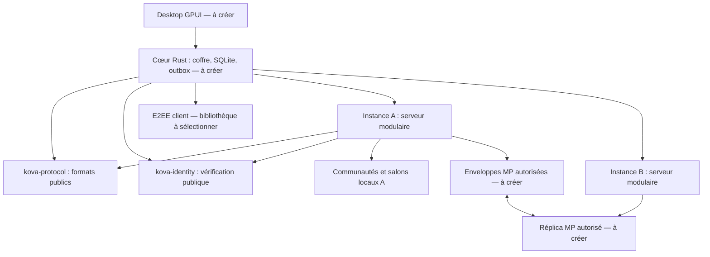

# Domaines et dépendances

Identité : indépendante de l'hébergeur, racine privée côté client. Communauté : profils, adhésions et autorisations locales. MP : participants globaux, consentement et événements chiffrés indépendants des communautés. Média : domaine réservé, hors MVP.

Les bibliothèques publiques ne dépendent ni du serveur ni de son stockage. Le serveur n'importe aucun module de génération ou stockage de secrets E2EE. La réplication future ne concerne que les conversations explicitement autorisées ; elle ne fédère pas les communautés.
